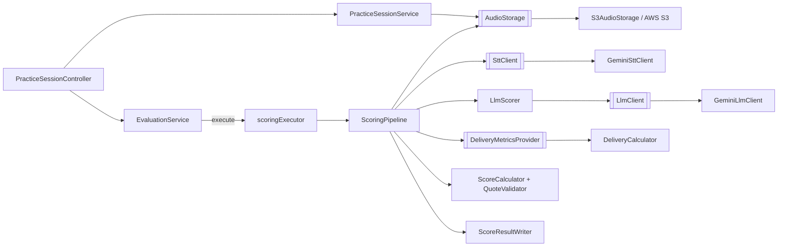

# Kiến trúc

## Tổng quan
Web API monolithic (Spring Boot, Java 21), 3 layer Controller -> Service -> Repository, PostgreSQL + Flyway. Người dùng luyện trả lời phỏng vấn bằng giọng nói; hệ thống STT, chấm theo rubric bằng LLM và trả điểm. Chấm điểm chạy bất đồng bộ (202 + polling). Chỉ đúng với **1 instance** (xem ADR-001).

## Thành phần AI/lưu trữ (adapter / port)
Mọi lệnh gọi ngoài nằm sau interface để test bằng `@MockitoBean`.

| Thành phần | Trách nhiệm | Vị trí (`M/`) |
|---|---|---|
| Port + adapter AI | STT, LLM, retry đúng 1 lần (`OneRetry`), ghi `ApiUsage` | `service/ai/` |
| Lưu audio | `AudioStorage` -> S3, khóa do server sinh | `service/storage/` |
| Chấm điểm thuần | `ScoreCalculator`, `RubricConfig`, `QuoteValidator`, Delivery | `service/scoring/` |
| Điều phối | `EvaluationService` (submit), `ScoringPipeline` (worker), `SessionRecoveryRunner` | `service/` |
| Executor | `scoringExecutor` (core 2 / max 4 / queue 20, `AbortPolicy`) | `config/AsyncConfig.java` |
| Cấu hình | `AiProperties`, `AudioProperties`, `AwsProperties`, `S3Config`, `GeminiHttpConfig` | `config/` |

## Quy tắc phụ thuộc
- Controller không chứa logic; kiểm sở hữu phiên chỉ qua `SessionAccess.requireOwned` (404 không tồn tại, 403 của người khác).
- Phần tính điểm (`service/scoring`) thuần, không I/O.
- Không thêm lệnh gọi mạng trực tiếp trong service: đi qua port.

## Cross-cutting
- Auth: JWT, `anyRequest().authenticated()` (`config/SecurityConfig.java`).
- Lỗi: `ApiException` + `GlobalExceptionHandler` -> `ErrorResponse{code,message,timestamp,fieldErrors}`; multipart quá cỡ/thiếu part -> 400 `VALIDATION_ERROR`.
- Giờ: `Clock` bean (`config/ClockConfig.java`) cho mọi mốc thời gian.

## Hạ tầng & môi trường
Biến môi trường: xem `.env.example` và README. Test dùng `backend/src/test/resources/config/application.yml` với giá trị giả (không gọi Gemini/S3 thật). Triển khai: Docker + Render.

## Điểm nóng & rủi ro
Đơn instance; `durationSeconds` do client khai; phụ thuộc độ trễ Gemini. Chi tiết: [tech-debt.md](tech-debt.md).

Cập nhật lần cuối: 2026-11-04
