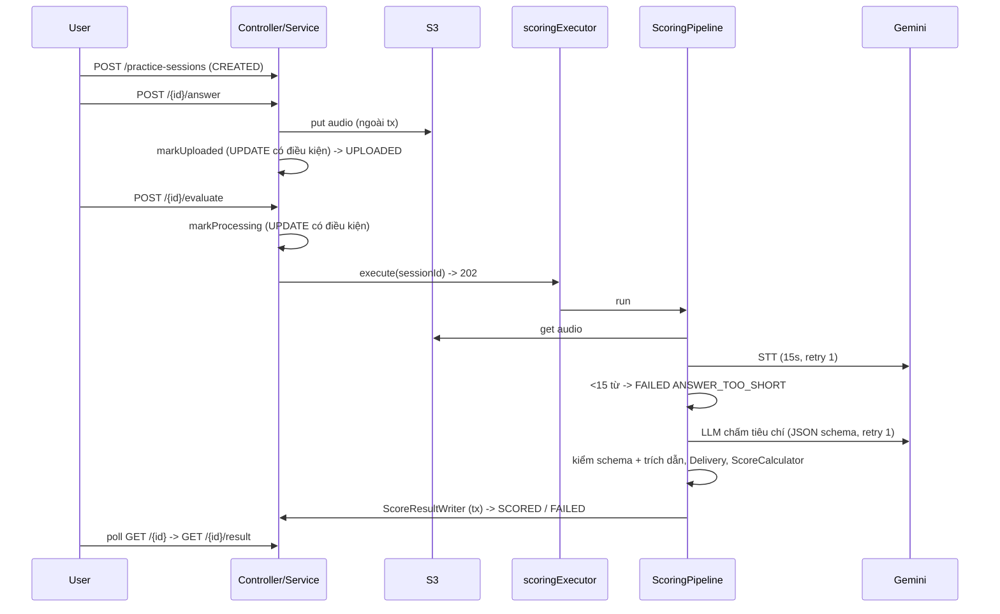

# Luồng: tạo phiên -> upload -> chấm điểm

## Mục đích & tác nhân
Người dùng đã đăng nhập luyện 1 câu hỏi và nhận điểm theo rubric (RB). Tác nhân: user, worker nền, Gemini, S3.

## Điểm vào
`M/controller/PracticeSessionController.java`: `POST /practice-sessions` (201), `POST /{id}/answer` (multipart `audio` + `durationSeconds`), `POST /{id}/evaluate` (202), `GET /{id}`, `GET /{id}/result`.

## Diễn biến

1. Upload: kiểm sở hữu -> duration [10,180] -> MIME whitelist + đuôi + <=10MB -> trạng thái; S3 `put` rồi `markUploaded` (`PracticeSessionService`).
2. Evaluate: `EvaluationService.submit`; executor từ chối -> `revertToUploaded` + 503.
3. Worker `ScoringPipeline.run`: STT -> đếm từ theo khoảng trắng -> `LlmScorer` (tối đa 2 lần gọi LLM) -> `QuoteValidator` -> `DeliveryMetricsProvider` -> `ScoreCalculator` -> `ScoreResultWriter`.

## Dữ liệu chạm tới
`practice_sessions` (trạng thái, `audio_key`, `error_code`, `processing_started_at`), `score_results` (UNIQUE `session_id`), `score_criteria`, `api_usage`. Không migration mới (V1 đủ).

## Quy tắc nghiệp vụ & ràng buộc
- Trạng thái: CREATED -> UPLOADED -> PROCESSING -> SCORED/FAILED; FAILED -> upload lại/evaluate lại được.
- Server tự tính điểm (`totalScore = Σ wᵢ(sᵢ-1)/4`, Delivery null chia lại trọng số, `offTopic` cap 30, HALF_UP 1 chữ số); bỏ qua `totalScore` LLM trả. Điểm ngoài 1-5/không nguyên = sai schema.
- Quote: `score>=3` mà quote không có trong transcript (đã chuẩn hóa) -> `score=2`, `quoteInvalid`. >50% quote sai -> retry LLM 1 lần (đúng 50% thì không).
- Injection: `injectionSuspected=true` vẫn chấm, lưu `score_results.injection_suspected`, log WARN chỉ sessionId/userId.

## Lỗi & trường hợp biên
| Tình huống | Kết quả |
|---|---|
| Phiên người khác / không tồn tại | 403 `FORBIDDEN` / 404 `NOT_FOUND` |
| evaluate/answer khi PROCESSING | 409 `SESSION_PROCESSING` |
| evaluate/answer khi SCORED | 409 `SESSION_ALREADY_SCORED` |
| result khi chưa SCORED | 409 `SESSION_NOT_READY` |
| S3 lỗi / hàng đợi đầy | 503 `SERVICE_UNAVAILABLE` (hàng đợi đầy: hoàn tác về UPLOADED) |
| Lỗi nền | FAILED + `STT_ERROR`, `LLM_ERROR`, `INVALID_RESULT`, `ANSWER_TOO_SHORT`, `INTERNAL_ERROR` |
| Restart khi đang PROCESSING | `SessionRecoveryRunner` -> FAILED `SERVER_RESTART` |

## Phụ thuộc chéo
Đổi mã lỗi -> cập nhật OA + Data_Dictionary. Đổi trọng số -> `RubricConfig` + RB + `RUBRIC_VERSION`. Đổi prompt -> `PROMPT_VERSION`.

## Test hiện có
`PracticeSession*IntegrationTest`, `EvaluationPipelineIntegrationTest`, `EvaluateConcurrencyTest`, `MultipartErrorHandlingTest`, `ScoreCalculatorTest`, `QuoteValidatorTest`, `LlmScorerTest`... (xem `specs/AI-PIPELINE/test-report.md`). Không test nào gọi Gemini/S3 thật.

Cập nhật lần cuối: 2026-11-04
